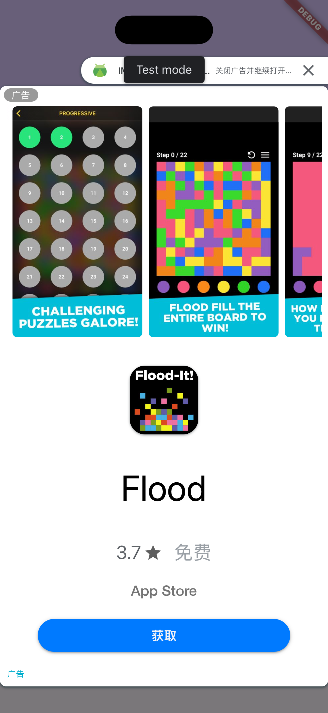
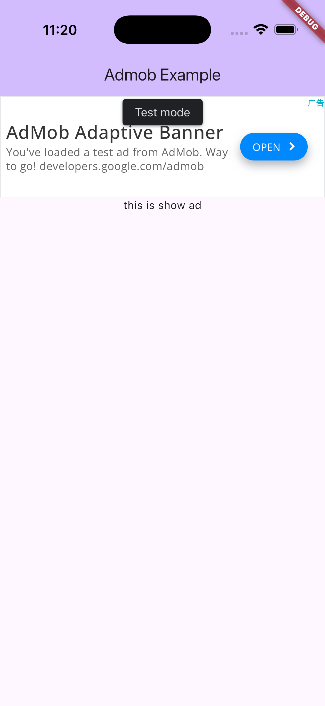

[](https://lunagao.github.io/BlessYourCodeTag/)


Easy to implement AdMob using GetX in Flutter. Only support __Android__ and __iOS__.

> __Note__: **0.1.0 version and above** are using for **Flutter 3.44.0 and above** (iOS package is using Swift Package). If you are using Flutter 3.41.9 and below (iOS using Pod), please use 0.0.2 version.

## Features

* Banner and app open ads for Android and iOS.
* Startup preloading or on-demand banner loading.
* Banner caching by ad unit and width.
* Bounded retries with 2, 4 and 8 second backoff delays.
* Standard and large adaptive banner size policies.
* Structured app open diagnostics without an analytics dependency.

| Feature | Screenshot | Feature | Screenshot |
| --- | --- | --- | --- |
| open app ad |  | banner ad |  |

## Installation

Add `getx_admob` to your `pubspec.yaml`:

```yaml
dependencies:
  getx_admob: ^0.3.1
```

Then run `flutter pub get`.

## Getting started

Steps: 
* Import this package.
* Add admob application ID
  * iOS Info.plist
  * Android AndroidManifest.xml
* Add app_ad_units.dart file.
* Modify main.dart file.
* Modify my_app.dart file.
* Modify page, add banner ad.


## Usage

According to the [official documentation](https://developers.google.com/admob/flutter/quick-start),

Configure your AdMob application ID.
* Add iOS Info.plist.
* Add AndroidManifest.xml.

#### ios/Runner/Info.plist
```xml
<plist version="1.0">
<dict>
	<!-- ... -->
	<key>GADApplicationIdentifier</key>
	<string>ca-app-pub-3940256099942544~1458002511</string>
</dict>
</plist>
```

#### android/app/src/main/AndroidManifest.xml
```xml
<manifest>
    <application>
        <!-- ... -->
        <meta-data
            android:name="com.google.android.gms.ads.APPLICATION_ID"
            android:value="ca-app-pub-3940256099942544~3347511713"/>
    </application>
</manifest>
```


## Code example

Add app_ad_units.dart file
```dart
import 'package:getx_admob/getx_admob.dart';

class AppAdUnits {
  static List<AdmobUnitId> adUnits = [
    AppAdUnits.homeBanner,
    AppAdUnits.detailBanner,
    /// ... add more AdmobUnitId
  ];

  static AdmobUnitId homeBanner = AdmobUnitId(
    androidUnitId: 'ca-app-pub-3940256099942544/9214589741',
    iosUnitId: 'ca-app-pub-3940256099942544/2435281174',
  );

  static AdmobUnitId detailBanner = AdmobUnitId(
    androidUnitId: 'ca-app-pub-3940256099942544/9214589741',
    iosUnitId: 'ca-app-pub-3940256099942544/2435281174',
  );

  /// ... add more AdmobUnitId
}
```

main.dart
```dart
// ...
import 'package:example/app_ad_units.dart'; // <-- import getx admob ad units
import 'package:flutter/material.dart';
import 'package:get/get.dart';
import 'package:getx_admob/getx_admob.dart'; // <-- import getx admob
void main() async {
  // ensure initialized
  WidgetsFlutterBinding.ensureInitialized(); // <-- ensure initialized, MUST ADD THIS
  // ...
  // init admob service
  await Get.putAsync(
    () => AdmobService().init(
      adUnitIds: AppAdUnits.adUnits,
      // using for production
      appOpenAdUnitId: AdmobUnitId(
        androidUnitId: 'OPEN_APP_AD_UNIT_ID_ANDROID',
        iosUnitId: 'OPEN_APP_AD_UNIT_ID_IOS',
      ),
      bannerSizePolicy: AdmobBannerSizePolicy.largeAdaptive,
      onDiagnostic: (event) => debugPrint(event.toString()),
    ),
  );
  // ...
  runApp(const MyApp());
}
```

my_app.dart
```dart
import 'package:flutter/material.dart';
import 'package:get/get.dart';
import 'package:getx_admob/getx_admob.dart'; // <-- import getx admob
class MyApp extends StatelessWidget {
  const MyApp({super.key});

  @override
  Widget build(BuildContext context) {
    return GetMaterialApp(
      // ...
      builder: (context, child) {
        return AdaptiveAdLoader(
          preloadAllBanners: false,
          child: child,
        );
      },
    );
  }
}
```

home_page.dart
```dart
// ...
import 'package:example/app_ad_units.dart'; // <-- import getx admob ad units
import 'package:flutter/material.dart';
import 'package:getx_admob/getx_admob.dart'; // <-- import getx admob

class HomePage extends StatelessWidget {
  const HomePage({super.key});
  @override
  Widget build(BuildContext context) {
    return Scaffold(
      body: Column(
        mainAxisAlignment: .center,
        children: [
          // ...
          AppBannerAd(AppAdUnits.homeBanner), // <-- add getx admob banner ad
          // ...
        ],
      ),
    );
  }
}
```

## Banner loading

`AdaptiveAdLoader` keeps the original behavior by default: `preloadAllBanners` is `true`, so every registered banner is loaded when the app starts and when the screen width changes.

Set `preloadAllBanners: false` to load a banner only when its `AppBannerAd` is mounted. Loaded banners are cached per widget instance by ad unit and width, so rebuilding the same widget does not request the same banner again. Each widget instance owns a separate `BannerAd`, which is released after the widget is disposed and is never shared with another `AdWidget`. A width change creates a separate cache entry and leaves other banner sizes untouched.

The existing full-loading API remains available:

```dart
Get.find<AdmobService>().loadAllAds(width);
```

A specific banner can also be loaded explicitly in either mode:

```dart
Get.find<AdmobService>().ensureBannerLoaded(AppAdUnits.homeBanner, width);
```

A failed banner load is retried after 2, 4 and 8 seconds, with at most three retries. After the final failure, requests stop until the banner widget is mounted again or `ensureBannerLoaded` is called explicitly. Timers are cancelled when their cache entry or the service is disposed.

## Banner size policy

The default policy is `AdmobBannerSizePolicy.largeAdaptive`, which preserves the existing behavior. Use `AdmobBannerSizePolicy.standardAdaptive` to run a standard adaptive banner comparison:

```dart
AdmobService().init(
  adUnitIds: AppAdUnits.adUnits,
  appOpenAdUnitId: appOpenAdUnitId,
  bannerSizePolicy: AdmobBannerSizePolicy.standardAdaptive,
);
```

Compare layouts, impressions, match rate and eCPM separately before changing the default in an application.

## App open diagnostics

Pass `onDiagnostic` to `AdmobService.init` to receive `AdmobDiagnosticEvent` objects for app open load, availability, expiration, show and dismiss events. Events include the ad unit, timestamp, relevant duration and, for failures, the AdMob error code, domain and message.

The service also exposes `isAppOpenAdLoading`, `isAppOpenAdAvailable`, `isAppOpenAdShowing` and `appOpenLoadTime`. No analytics dependency is added; applications can decide how to record these events.

## Android example

The included example enables on-demand banner loading, standard adaptive banners and app open diagnostics. Its Android build uses Gradle 9.1.0 and has been verified with JDK 25 on Android 16. Java source and target compatibility remain at Java 17.

Run the example with AdMob test units:

```bash
cd example
flutter pub get
flutter run --dart-define=DEBUG_AD=true
```

Build the debug APK:

```bash
flutter build apk --debug
```

## VS Code launch.json

You can use VS Code launch configurations to enable or disable ads and select test or production ad units. Production ad units are used by default.

launch.json example
```json
{
    "version": "0.2.0",
    "configurations": [
        {
            "name": "getx_admob [disable ad]",
            "request": "launch",
            "type": "dart",
            "args": [
                "--dart-define",
                "ENABLE_AD=false"
            ]
        },
        {
            "name": "getx_admob [use debug ad]",
            "request": "launch",
            "type": "dart",
            "args": [
                "--dart-define",
                "DEBUG_AD=true"
            ]
        },
        {
            "name": "getx_admob [use production ad]",
            "request": "launch",
            "type": "dart"
        }
    ]
}
```

## Additional information

Welcome to contribute to this package.

https://github.com/LunaGao/getx_admob
